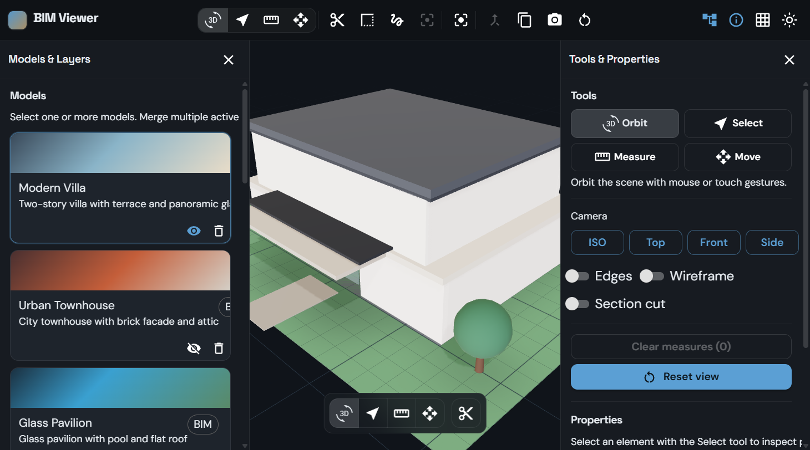
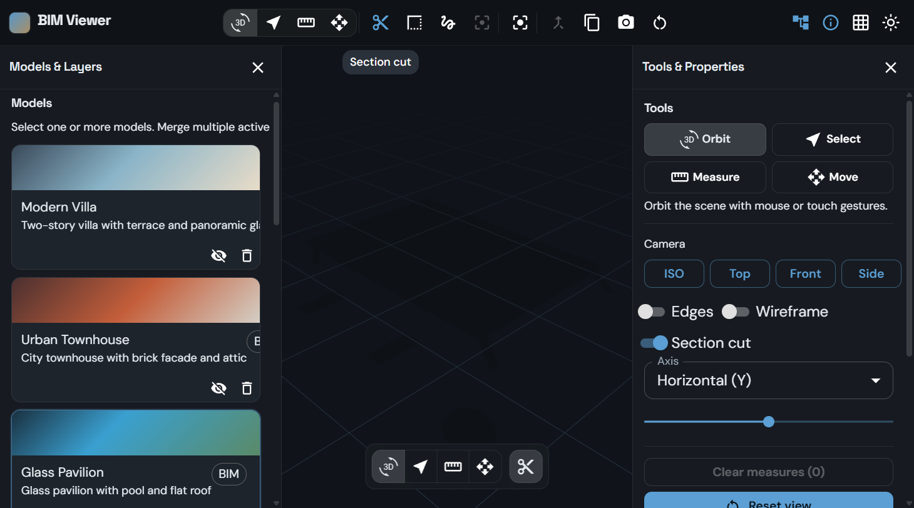
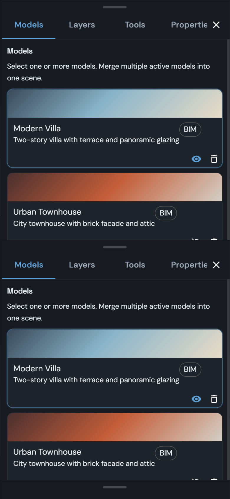

# BIM Viewer

A React BIM-style 3D viewer for inspecting building models in the browser. Switch between house models, toggle layers, measure distances, move or hide elements, cut sections, upload GLB/GLTF files, and merge scenes.



## Features

- **Preset models:** Modern Villa, Urban Townhouse, Glass Pavilion
- **Layers:** show/hide, opacity, explode view
- **Tools:** orbit, select, measure, move (gizmo), section cut
- **Top command bar:** edges, wireframe, isolate selection, camera presets, merge/duplicate, screenshot, reset
- **Upload:** drop `.glb` / `.gltf` models onto the scene
- **Merge / duplicate** active models
- **Responsive UI:** side panels on desktop (open/close), bottom sheet on mobile
- **MUI + SCSS** theming (dark / light)



## Screenshots

Real screenshots captured from the running application:

| Desktop | Mobile |
| --- | --- |
|  |  |

## Quick start

```bash
cd bim-viewer
npm install
npm start
```

Open [http://localhost:3000](http://localhost:3000) (or the port shown in the terminal).

Production build:

```bash
npm run build
```

## Stack

- React 19 + TypeScript
- MUI
- React Three Fiber / Three.js / Drei
- Zustand
- SCSS

## Project layout

```
src/
  components/
    layout/     # shell, top bar, bottom toolbar
    panels/     # models, layers, tools, properties, upload
    viewer/     # canvas, elements, measure, section
  data/         # preset procedural house models
  store/        # zustand BIM state
  styles/       # SCSS theme
  theme/        # MUI theme
  types/        # shared TypeScript types
```

## Top toolbar actions

| Control | Action |
| --- | --- |
| Orbit / Select / Measure / Move | Active interaction mode |
| Section | Enable clipping plane |
| Edges / Wireframe | Display modes |
| Isolate | Hide everything except selection |
| Fit / Top / Front / Side | Camera presets |
| Merge / Duplicate | Model operations |
| Screenshot | Download PNG of the viewport |
| Reset | Clear measures, section, explode, camera |

## License

MIT
